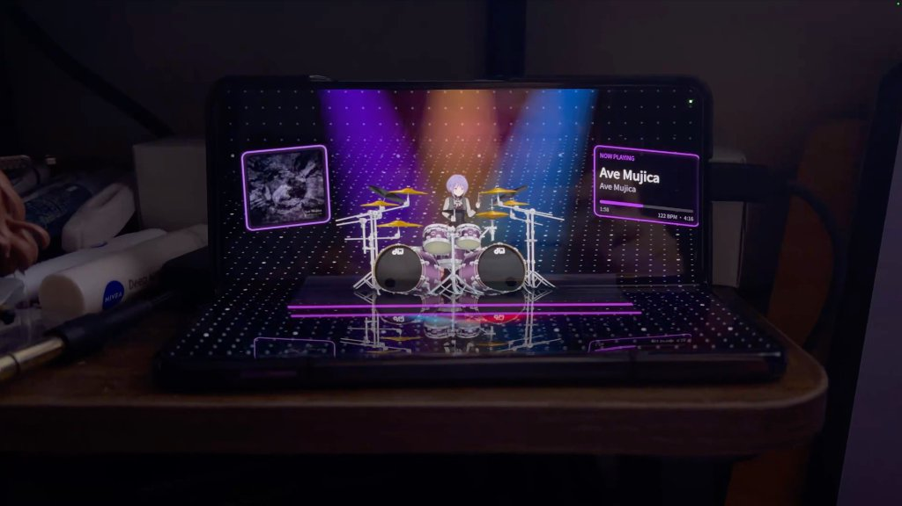

# 裸眼 3D Live2D 全息舞台 - 折叠设备



**裸眼 3D Live2D 全息舞台 - 折叠设备（FoldStage）** 是一个面向折叠屏手机的**裸眼 3D Live2D 全息舞台**开源框架，包含 Android 独立全息端与跨平台（**macOS / Windows**）桌面伴侣工具。

把折叠屏半折放在桌上：下半屏作为 3D 地板，上半屏作为纵深背墙。前置摄像头实时追踪你的眼睛三维位置，通过离轴透视投影（Robert Kooima 方法）+ 折痕圆弧分条渲染，为你当前视角呈现立体裸眼 3D 舞台；通过 **USB 或局域网 Wi-Fi** 连接电脑后，还可实时捕获电脑上**任意指定播放器 App** 的音乐节拍与歌曲信息，驱动 Live2D 演奏模型（站姿乐手 / 坐姿鼓组）踩点演出。

> **重要说明**
> - **设备适配范围**：目前仅在 **Samsung Galaxy Z Fold 5（`SM-F9460`）** 上完成实机验证与参数校准（屏幕物理尺寸 `14.70 × 12.2 cm`、屏下前摄位置、连续折角加速度计解算均基于 Fold 5 实测）。其他折叠屏及普通直板手机 / 平板内置**基础退化体验模式**（可在手机端「调参」中切换「通用折叠屏」或「直板 / 平板」预设，手动调整屏幕尺寸、折角与触控预览）。欢迎提交 PR 补充更多机型参数。
> - **模型精细校准范围**：目前**经过精细调整的 Live2D 模型只有「祐天寺若麦演出服」和「祐天寺若麦打鼓」两套**（其中打鼓模型支持自动 4 层立体景深分离）。其他自行导入的 Live2D 模型虽支持自动包围盒居中、脚底贴地与通用演奏动作解析，但在身高比例、摆放位置、动作衔接或景深表现上**可能会存在偏差**，可在手机端「调参」面板中自行微调「角色身高」「站位前后」「节拍偏移」等参数。
> - **纯代码开源**：本公开仓库**不包含任何角色 Live2D 模型素材**。请使用桌面端「Live2D 模型库」窗口拖入你自己下载的 Cubism 3/4 Live2D `.zip` 模型压缩包（见文末模型获取地址）。
> - **观感与折痕反光提示**：由于折叠屏折痕处容易反光，环境顶灯直射可能导致裸眼 3D 穿帮。如需更好的立体观感，建议**关闭正上方的灯光**，或尝试更换一张**磨砂抗反光膜**。**更换贴膜前请务必确认您的折叠屏设备是否支持用户自行更换内屏保护膜（部分折叠屏自行撕换原厂内屏膜可能损坏屏幕或影响保修）。**

---

## AI Agent 一键自动部署指南（For AI Coding Agents）

> 如果你是用户，可以直接把本仓库网址发给你的 AI 编程助手（Antigravity / Claude Code / Cursor / Codex 等），说「**帮我把这个项目部署到我的电脑和手机上**」。  
> 如果你是 AI Agent，请严格按以下步骤检测环境、编译并完成部署：

### Step 0：克隆仓库与环境检测
```bash
git clone https://github.com/YIN-YUNQING/FoldStage.git
cd FoldStage
```
检查必需依赖：
- **Node.js 18+**（桌面端核心零 npm 依赖，直接 `node` 运行；无需执行 `npm install`）
- **ADB (`adb`)**：用于 USB 连接与安装 APK（macOS：`brew install android-platform-tools`；Windows：`winget install Google.PlatformTools`）
- **构建 Android APK 需要**：JDK 11+ 与 Android SDK（设置 `ANDROID_HOME`，包含 `build-tools` 和 `platforms/android-34`）。
  - *无本地 Android SDK 时的免编译方案*：直接前往本仓库 [GitHub Actions](https://github.com/YIN-YUNQING/FoldStage/actions) 最新一次绿色构建，下载产物 `foldstage-android-apk`（解压得到 `foldstage.apk` 放到 `android/out/foldstage.apk`），Windows 也可顺手下载 `foldstage-windows-native`（得到单文件 `foldstage-audio-win.exe` 放到 `desktop/native/windows/publish/`）。

### Step 1：拉取前端依赖并构建 Android 独立离线 APK（约 9 MB）
```bash
node scripts/fetch-deps.mjs
bash android/build.sh
# 产物位置：android/out/foldstage.apk（包名 com.foldstage.app）
```
- `fetch-deps.mjs` 会下载 Three.js、PIXI、pixi-live2d-display、Live2D Cubism Core 及离线 MediaPipe FaceLandmarker（WASM + `.task`）到 `web/vendor/`。
- `android/build.sh` 会自动生成本地临时签名 `android/keystore/debug.keystore`，并将离线资源打进 `android/out/foldstage.apk`。

### Step 2：编译并启动桌面伴侣（按用户操作系统二选一）

#### macOS（14.2+）
```bash
chmod +x desktop/native/macos/build.sh
zsh desktop/native/macos/build.sh
# 编译产物：
#   desktop/native/macos/build/np.dylib
#   desktop/native/macos/build/foldstage-audio-mac
#   desktop/native/macos/FoldStage Companion.app

# 启动图形界面（自动拉起后端并打开原生窗口）：
open "desktop/native/macos/FoldStage Companion.app"
# 或命令行启动：
# node desktop/start.mjs
```
- 权限提醒（需由用户手动在系统弹窗点击允许）：
  1. 首次点击「开始识别音乐」时，macOS 会要求允许 **「屏幕与系统音频录制」** 权限。
  2. 如需**局域网 Wi-Fi 无线连接**且 macOS 开启了防火墙，需放行 `node` 的传入连接。

#### Windows（Windows 10 20348+ / Windows 11）
```powershell
# 需要 .NET 8 SDK（或直接放入从 GitHub Actions 下载的 foldstage-audio-win.exe）：
.\desktop\native\windows\build.ps1
# 产物：desktop\native\windows\publish\foldstage-audio-win.exe（自包含单文件，无需目标机装 .NET 运行时）

# 启动桌面图形界面（自动打开 Edge/Chrome 独立应用窗口）：
desktop\native\windows\FoldStage-Windows.bat
# 或：
# node desktop/start.mjs
```
- 首次启动如弹出 Windows Defender 防火墙提示，允许在专用网络访问以便局域网 Wi-Fi 无线连接。

### Step 3：安装 APK 到手机并验证连通性
- **方式 A（USB 连接，推荐首次安装）**：
  1. 手机开启开发者选项 → USB 调试，连上电脑并在手机端允许调试。
  2. 执行安装与端口转发（桌面端运行中也会每 2.5 秒自动执行 `adb reverse`）：
     ```bash
     adb install -r android/out/foldstage.apk
     adb reverse tcp:8772 tcp:8772
     adb shell am start -n com.foldstage.app/.MainActivity
     ```
- **方式 B（纯局域网 Wi-Fi 无线装包，无需数据线）**：
  1. 确认手机和电脑在同一 Wi-Fi 下。
  2. 在桌面窗口查看显示的「局域网地址」（如 `http://192.168.x.x:8772`），手机浏览器直接访问 `http://<电脑IP>:8772/download/foldstage.apk` 下载安装。
  3. 打开手机端 App，会自动通过 UDP `8773` 发现电脑并显示 `Wi-Fi 已连`（若路由器屏蔽 UDP 广播，可在手机右上角「调参」→「局域网」手动填入 `<电脑IP>:8772`）。

### Step 4：部署自检命令（供 Agent 校验）
```bash
# 1. 验证桌面端服务监听 8772 且状态正常
curl -s http://127.0.0.1:8772/api/status

# 2. 验证节拍 DSP 核心算法（128 BPM 合成信号自测）
node desktop/core/beat-dsp.mjs

# 3. 确认手机端已连上且模型列表可访问
curl -s http://127.0.0.1:8772/v1/models
```

---

## 核心特性

1. **Android 独立离线全息端（`com.foldstage.app`）**
   - 离轴透视 + 折痕圆弧分条渲染 + 折痕亮度平衡蒙版。
   - **完全离线前摄眼追**：将 MediaPipe FaceLandmarker（WASM + `.task`）与 Web 引擎打进 APK 本地服务（`127.0.0.1:18772`），断网/无代理也能运行眼追（无权限或无前摄时自动回退触控预览）。
   - **通用 Live2D 模型渲染**：自动按实际不透明像素包围盒居中并贴地 / 贴舞台台面；自动识别站姿展示模型、站姿演奏模型与 4 层立体景深鼓组模型。
   - **可选 AR 透明窗**：利用后置主摄在背墙透出真实环境（默认关闭，内置温控自动关闭保护）。
   - **离线模型存储**：通过电脑端同步进手机后，拔掉 USB 或断开 Wi-Fi 依然可离线展示与切换模型。

2. **跨平台桌面伴侣（macOS & Windows）**
   - **统一图形界面 Studio GUI**：打开即可管理设备连接、选择音源 App、拖入 `.zip` 模型并一键同步到手机。
   - **USB + 局域网 Wi-Fi 双通道**：
     - **USB 优先**：自动检测 Android 设备并建立 `adb reverse tcp:8772 tcp:8772`，一键安装 / 启动 APK。
     - **局域网 Wi-Fi 无线模式**：桌面端在 `0.0.0.0:8772` 开放 `/v1/*` 音乐与模型接口（`/api/*` 控制接口严格限制仅本机访问），并广播 UDP `8773` 自动发现信标，拔线后手机自动无缝切换 `Wi-Fi 已连`。
   - **通用音源 App 指定**：
     - **macOS 14.2+**：Core Audio Process Tap，可指定任意正在运行的 App（网易云、Spotify、Apple Music、QQ 音乐、浏览器等）或 `All System Audio`，配合 MediaRemote 读取歌名 / 歌手 / 封面 / 进度。
     - **Windows 10 (20348+) / Windows 11**：WASAPI Process Loopback 按进程捕获指定播放器音频（旧版 Windows 支持 `All System Audio` 回环），配合 Windows GSMTC 读取歌名 / 歌手 / 封面 / 进度。
   - **共享实时节拍引擎**：三频段频谱通量 + 8 秒自相关 BPM 估计 + 梳状相位 + 锁相平滑 + 4/4 小节重拍识别；另附内置演示节拍器便于无音乐时测试。
   - **`.zip` 模型智能导入**：纯 Node.js 解压与解析，自动识别 `model3.json` / `*.model3.json`、贴图和动作文件；检测到 `mtn_play01_*` / `mtn_play02_*` 等演奏动作时自动归类为「音乐演奏模型」。

---

## 日常使用步骤

1. 打开桌面伴侣（macOS 运行 `FoldStage Companion.app`，Windows 运行 `FoldStage-Windows.bat`）。
2. 用 USB 连上手机（或连入同一 Wi-Fi），安装并打开手机端「裸眼3D全息舞台」。
3. 将下载好的 Live2D `.zip` 模型压缩包直接拖入桌面端 **「Live2D 模型库」** 窗口，点击 **「同步模型到手机」**（或等待自动同步）。
4. 在 **「电脑音源选择与节拍识别」** 中选择你的播放器 App，点击 **「开始识别音乐」**，手机端即可随音乐实时踩点演出。

---

## 目录结构

```text
foldstage/
├── android/                  # Android 原生壳 (com.foldstage.app) 与构建脚本
├── web/                      # 裸眼 3D Live2D 全息 Web 引擎
├── desktop/
│   ├── core/                 # 跨平台伴侣服务 (Node.js 零外部依赖): HTTP/SSE、UDP 发现、DSP、ZIP 导入、ADB
│   ├── ui/                   # 桌面伴侣图形界面 Studio GUI
│   ├── native/
│   │   ├── macos/            # macOS 原生 Core Audio 捕获助手 + WKWebView .app 封装
│   │   └── windows/          # Windows 原生 WASAPI Process Loopback + GSMTC (.NET 8)
│   └── start.mjs             # 跨平台启动入口
├── scripts/fetch-deps.mjs    # 拉取前端依赖与离线 MediaPipe 资源（不进仓库）
└── docs/
    ├── cover.jpg             # README 实拍封面图
    ├── social-preview.jpg    # GitHub Social Preview (1280×640) 分享卡片图
    └── USB-MUSIC-PROTOCOL.md # 开放 USB / LAN 音乐与模型同步协议说明
```

---

## 开放 USB / 局域网音乐协议

如果你想用自己的脚本（Python / Node / OBS / Foobar2000 插件等）或 Linux 桌面端给 FoldStage 推送节拍与曲目信息，直接向 `POST http://127.0.0.1:8772/v1/music` 发送 JSON 即可。详见 [docs/USB-MUSIC-PROTOCOL.md](docs/USB-MUSIC-PROTOCOL.md)。

## License

MIT License — 见 [LICENSE](LICENSE)。  
Live2D Cubism Core SDK 归 Live2D Inc. 所有，由 `scripts/fetch-deps.mjs` 在本地构建时从官方地址下载，不包含在本仓库中。

---

## 致谢与 Live2D 模型获取

感谢 [Haneoka Live2D](https://haneoka.org/intl/zh-CN/live2d/) 提供便捷的 Live2D 模型资源浏览与下载服务（https://haneoka.org/intl/zh-CN/live2d/）。

从该网站下载得到的 Live2D `.zip` 压缩包无需解压，**直接拖进桌面端「Live2D 模型库」窗口即可自动识别并同步到手机使用**。
